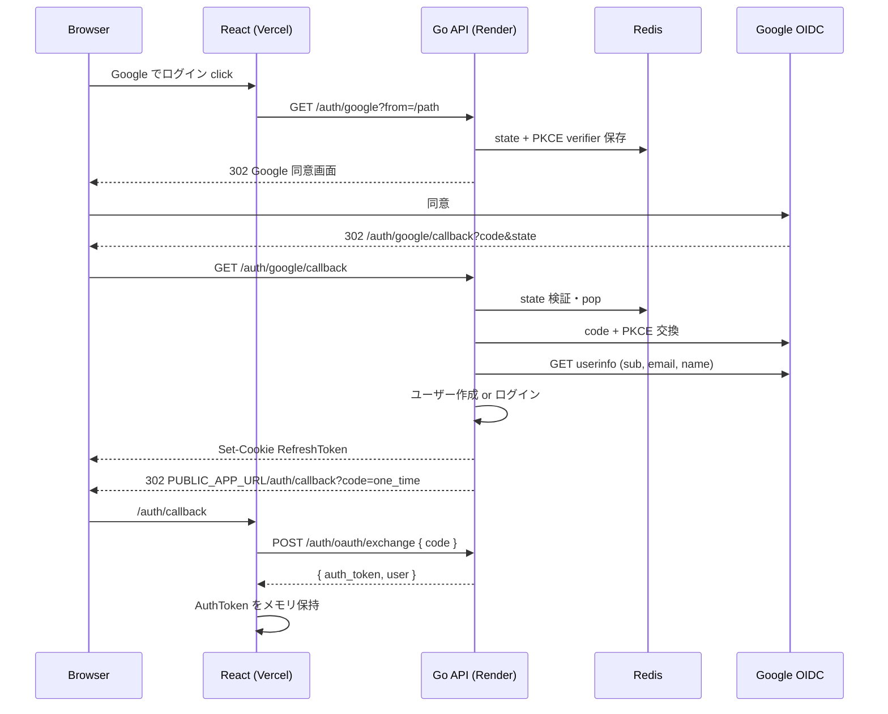

# Google OAuth / OIDC フロー（実装）

フロントは **react-oidc-context を使わない**。Google OIDC は **Go バックエンドが Authorization Code + PKCE** で処理し、自社 **AuthToken（JWT）+ RefreshToken（httpOnly Cookie）** を発行する。

## トークンの区別

| トークン | 保持場所 | 用途 |
|----------|----------|------|
| Google access token | サーバー内のみ（短命） | userinfo 取得後破棄 |
| AuthToken（自社 JWT） | フロント **メモリ** | API `Authorization: Bearer` |
| RefreshToken | **httpOnly Cookie** | `POST /auth/refresh` |
| OAuth state / PKCE | **Redis**（TTL 10 分） | CSRF・コード交換 |

## 新規 Google ログイン（BUYER）

## 既存メールアドレスとの連携

Google email が既存 Credentials アカウントと一致する場合:

1. コールバックで `requires_link=true` → `/oauth/link-confirm?google_email=...`
2. ユーザーが **パスワード** を入力
3. `POST /auth/oauth/exchange { code, password }` で連携完了

## スコープ・エンドポイント

| 項目 | 値 |
|------|-----|
| Scopes | `openid`, `email`, `profile` |
| UserInfo | `https://openidconnect.googleapis.com/v1/userinfo` |
| PKCE | `S256` code_challenge |
| 対象ロール | **BUYER のみ**（SELLER/ADMIN は Credentials + 2FA） |

## 環境変数

| 変数 | 説明 |
|------|------|
| `GOOGLE_CLIENT_ID` | OAuth クライアント ID |
| `GOOGLE_CLIENT_SECRET` | クライアントシークレット |
| `GOOGLE_REDIRECT_URI` | 未設定時 `{API_PUBLIC_URL}/auth/google/callback` |
| `PUBLIC_APP_URL` | フロント URL（コールバックリダイレクト先） |
| `API_PUBLIC_URL` | API 公開 URL |
| `REDIS_URL` or `REDIS_ADDR` | OAuth state 保存（**必須**） |
| `CORS_ALLOW_ORIGINS` | フロントオリジン |

## 関連 API

| メソッド | パス | 説明 |
|----------|------|------|
| GET | `/auth/google` | Google 同意画面へリダイレクト |
| GET | `/auth/google/callback` | code 交換 → Refresh Cookie → フロントへ |
| POST | `/auth/oauth/exchange` | ワンタイム code → AuthToken |
| POST | `/auth/refresh` | Cookie から AuthToken 再発行（失敗時 **204**） |

## フロント実装

| ファイル | 役割 |
|----------|------|
| `frontend/src/lib/api-client.ts` | `googleOAuthStartUrl()` |
| `frontend/src/pages/AuthCallbackPage.tsx` | code 交換 |
| `frontend/src/pages/OAuthLinkConfirmPage.tsx` | 既存アカウント連携 |
| `frontend/src/auth/AuthProvider.tsx` | メモリ AuthToken + refresh |

設定手順: [GOOGLE_OAUTH_SETUP.md](../GOOGLE_OAUTH_SETUP.md)  
障害対応: [runbooks/oauth.md](../runbooks/oauth.md)
